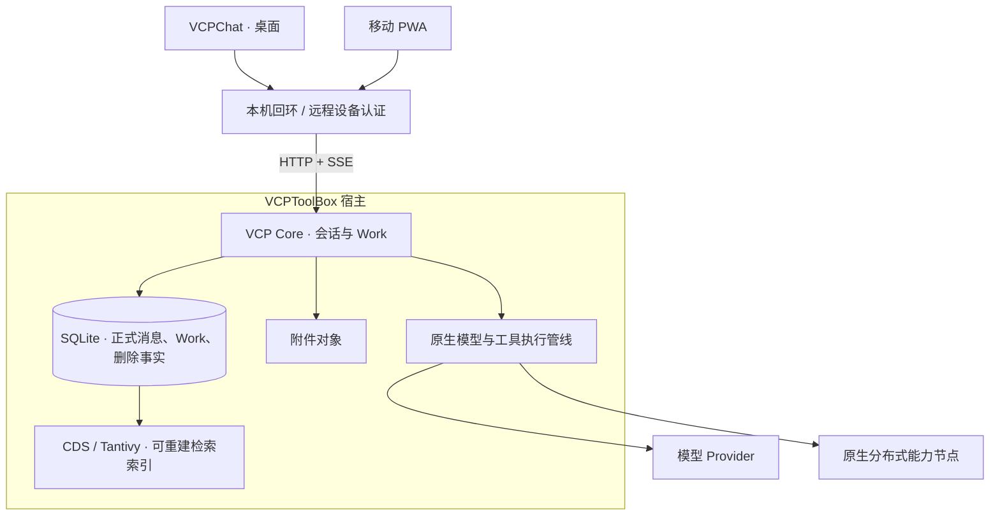

# VCP Integrated · VCP Core

**一个持续在线的 Agent 会话运行底座，连接桌面、手机与分布式能力节点。**

VCP Integrated 基于 [VCPToolBox](https://github.com/lioensky/VCPToolBox) 与 [VCPChat](https://github.com/lioensky/VCPChat)，在同一仓库中维护服务端、桌面客户端与移动端 PWA。

当前 `main` 已转向 **VCP Core** 架构。Core 由 ToolBox 宿主直接管理，统一负责正式会话、上下文装配、Work（执行工作项）及历史提交。本机与远程部署复用同一内核；用户可以关闭桌面、在手机上观察或追问，再从另一台设备接回原有会话，而不是在客户端之间复制执行状态。

> 当前阶段：**Pilot 01-R，个人日用试运行**。已完成本机及远程独立运行验证，尚非 VCP Core 1.0 稳定发行版。
>
> 固定候选：[vcp-core-v1-pilot-01-r](https://github.com/JENN2046/vcp-integrated/tree/vcp-core-v1-pilot-01-r) · [部署与设备配对](docs/core-pilot-01-r.md)

## 文档

[产品愿景与终局](docs/VISION.md) · [施工总纲](AGENTS.md) · [现行架构](docs/ARCHITECTURE.md) · [文档导航](docs/README.md) · [部署与配对](docs/core-pilot-01-r.md) · [历史档案与证据索引](docs/archive/README.md)

## 架构



| 组件 | 职责 |
| --- | --- |
| [VCP Core](apps/server/core) | 正式话题、配置快照、消息、Work、工具结果、设备接入与恢复决策。 |
| [VCPToolBox](apps/server) | 复用原生预处理、模型请求、工具循环及插件生态；管理 Core 生命周期。 |
| [VCPChat](apps/desktop) | 原生桌面交互、Agent 配置、会话视图及桌面能力节点。 |
| [移动端 PWA](apps/mobile) | 设备配对、话题浏览、附件展示、任务观察与继续交互。 |
| [共用模块](packages) | 复用原生聊天规则、消息处理及执行契约。 |

每个 Core 工作空间只有一个正式会话权威。SQLite 持久化已确认的会话事实，CDS/Tantivy 提供可重建的搜索索引。客户端不是正式历史的共同写入者；观察流断开也不等于 Work 被取消。Canvas、Workspace、游戏等领域资源仍由各自原生能力节点管理。

## 当前能力

- **持续执行与多端连续性**：桌面退出后，已受理 Work 可继续执行；设备重新连接后读取正式消息与附件，并可在权限范围内追问或追加指令。
- **统一会话与生命周期**：单聊、常规群聊、JEV 动态仲裁及斗地主公开会话已接入 Core。Agent 配置和话题删除保留删除墓碑，防止旧 ID 被静默复用。
- **原生能力继承**：复用 ToolBox 工具管线、AgentAssistant、TopicSponsor、单聊 Flowlock、上下文压缩、服务端 Agent 提示词别名，以及 Canvas、Workspace、活引用等资源接入。
- **记忆与检索**：ToolBox 运行原生日记检索及工具刷新。Core 按话题变更序号更新 CDS/Tantivy 的可重建投影，支持 DeepMemo 带权查询、相邻消息窗口及 TopicMemo 授权历史读取。
- **身份与数据连续性**：远程设备独立配对、权限检查及撤销；客户端绑定数据库 `storageId`，拒绝同址误接其他数据库。备份恢复保留原有消息、Work、附件和删除事实。
- **执行恢复边界**：请求重试核对原 Work；已确认事实可读回，副作用未知的执行保留待核对，不承诺所有工具均可自动重放。

上述能力以已验证的场景及原生权限为边界，并不意味着所有旧版功能均已迁移。[原生能力与边界](docs/evidence/core-closeout/README.md) · [高级群聊与记忆](docs/evidence/core-m4/README.md) · [RC-01 验收](docs/evidence/core-rc01/README.md)

## 快速开始

### 1. 构建

当前服务端主要构建及验收平台为 Linux x64 GNU。准备 Git、Node.js 24、npm、C/C++ 构建工具、Rust、OpenSSL，以及 Electron 所需系统库；图形联验还需要 Xvfb。依赖及原生组件按仓库锁文件构建。

```sh
git clone https://github.com/JENN2046/vcp-integrated.git
cd vcp-integrated
# 如需复现已验收的固定候选：
git checkout vcp-core-v1-pilot-01-r

npm run deps
npm run build
```

### 2. 选择运行模式

| 模式 | 用途 |
| --- | --- |
| `local` | ToolBox 与桌面在同一台设备；通过认证回环访问 Core。 |
| `remote` | 一个持续在线的 Core，多个已配对桌面和手机通过受信任的 HTTPS 入口接入。 |

本机与远程使用相同内核及数据格式。新试用请使用空的独立 Core 数据目录和桌面 Profile。

- **本机模式**：[独立本机 Core 启动说明](docs/evidence/core-closeout/README.md#pilot-启动与产物)，并参考 [当前数据库身份绑定说明](docs/core-pilot-01-r.md#数据库身份备份与恢复)。
- **远程模式**：[完整部署、HTTPS 与设备配对说明](docs/core-pilot-01-r.md)。使用独立设备凭据，远程 Core 不接受 ToolBox Key 冒充设备。
- **数据迁移与备份**：[历史导入边界](docs/evidence/core-closeout/README.md#离线迁移与六项历史夹具) · [备份恢复步骤](docs/core-pilot-01-r.md#数据库身份备份与恢复)。

部署远程模式时，后端保持回环监听，HTTPS 代理仅暴露必要的 Core 与 PWA 路径。请勿关闭证书校验，也不要直接覆盖既有日用数据目录或安装环境。

## 验证记录

下表记录 Pilot 01-R 的历史验收。本轮瘦身候选的验证范围见[现行架构](docs/ARCHITECTURE.md#当前纠偏路线与已知缺口)。

| 场景 | 已有证据 |
| --- | --- |
| 独立本机运行 | 移除 NativeSync 插件后，真实 Electron 发送、退出、Core 继续执行及后端重启读回通过。[回执](docs/evidence/core-closeout/local-core.json) |
| 远程多端 | Linux Electron 与实体 Android Firefox 经隔离 HTTPS 入口连续交互；两轮真实视觉模型请求、四条正式消息及原附件读回一致。[回执](docs/evidence/core-pilot-01-r/remote.json) |
| 日用数据风险 | 删除墓碑、原生提示词绑定、同地址换库拒绝、完整备份恢复通过隔离联验。[回执](docs/evidence/core-pilot-01-r/pilot-risk.json) |
| 原生与协作回归 | 原生 356 项通过、6 项历史夹具默认跳过；协作 61 项通过。六项历史夹具曾在 Pilot 01 单独恢复复验通过。 |

已构建 Linux ToolBox、Linux AppImage、Windows x64 客户端和 PWA 候选。Windows 安装器仍未签名，Windows 的验收范围主要为客户端安装与启动，服务端联验以 Linux 为主。当前没有 macOS 实机验收结论。

### 本地测试

完成依赖安装与构建后，在仓库根目录执行：

| 命令 | 用途 |
| --- | --- |
| `npm run test:native` | 默认原生回归，覆盖独立 Core、ToolBox 及桌面共用逻辑 |
| `CHROME_BIN=/path/to/chrome npm run test:collaboration` | 默认协作回归，使用 Chromium 验证原生执行、设备接入与 PWA |
| `npm run test:integration` | Linux 上独立本机与远程 Core 的 Electron 联验 |
| `VCP_TEST_CORE_RISK=1 npm run test:integration -- core-remote` | 远程删除、数据库身份及备份恢复专项 |

原生与协作套件可通过 `--test-name-pattern` 筛选，也可用 `npm run test:native -- -- core-group.test.cjs` 指定单个文件。集成测试可用 `XVFB_BIN` 指定 Xvfb。旧 Shared、VCPMobileSync wire 和旧普通工具组装场景在归档基线 `032ad5f` 复现，历史文档中的命令对应其原版本。见[历史档案](docs/archive/README.md)。

## 从 NativeSync 到 VCP Core

NativeSync 是本项目早期跨端集成与执行连续性研究的基础。VCP Core 吸收了其中成熟的设备接入、请求身份、工具回执、附件及恢复能力，将正式会话权威和执行生命周期收归服务端。

当前源码已退出 Shared 模式、旧设备授权适配、双向 History 同步、客户端接管和终稿补交。旧运行环境继续使用归档版本。原有数据目录与旧安装包均应独立保留。

既有独立 Core 数据目录可在核对工作空间及数据库身份后接续。对原生桌面 History 使用已有离线导入入口；跨话题重复消息 ID、无法定位的附件及非文本内联部件仍有明确导入限制。回退前请停机备份完整目录，并在独立副本中验证。 [数据库、备份与恢复](docs/core-pilot-01-r.md#数据库身份备份与恢复)

## 开发方向

- 以真实日用驱动稳定性、性能与原生功能完善，持续提升桌面和移动端体验。
- 保持与 VCPChat、VCPToolBox 上游能力的继承，减少不必要的私有分叉。
- Resident 正向 Provider Seal、生产可信客户端审批及 WebTransport 保持独立验证。现阶段客户端通信使用 HTTP + SSE，设备配对不等于可信人类审批资格。
- 持续完善跨平台交付和完整日用历史迁移。稳定后再进入 VCP Core 1.0。

## 版本与历史

| 引用 | 定位 |
| --- | --- |
| [main](https://github.com/JENN2046/vcp-integrated/tree/main) | 当前 VCP Core 开发主线 |
| [codex/vcp-core-v1](https://github.com/JENN2046/vcp-integrated/tree/codex/vcp-core-v1) | Core 开发分支 |
| [vcp-core-v1-pilot-01-r](https://github.com/JENN2046/vcp-integrated/tree/vcp-core-v1-pilot-01-r) | 固定的本机与远程日用候选 |
| [vcp-core-v1-pilot-01](https://github.com/JENN2046/vcp-integrated/tree/vcp-core-v1-pilot-01) | 固定的独立本机候选 |
| [codex/integration-main](https://github.com/JENN2046/vcp-integrated/tree/codex/integration-main) | 原 NativeSync 整合版历史基线 |

## 上游与许可

桌面端基于 [VCPChat](https://github.com/lioensky/VCPChat)，服务端基于 [VCPToolBox](https://github.com/lioensky/VCPToolBox)。本仓保留原作者与贡献者署名、宿主许可及导入版本记录。使用和分发时请查阅各组件许可。

[来源与署名](NOTICE.md) · [宿主来源记录](provenance) · [根许可证](LICENSE) · [组件许可证](LICENSES)
