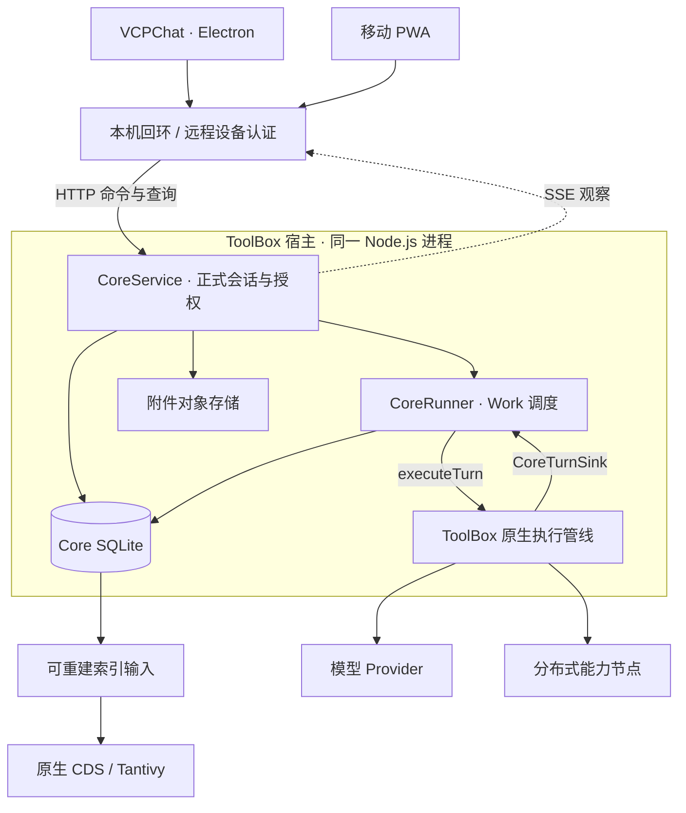
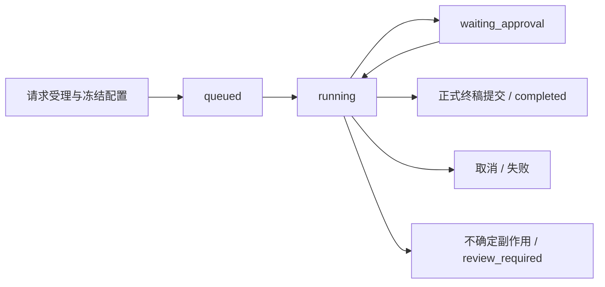

# VCP Core · 现行架构

**基线：Pilot 01-R（`0a1f358`）**。本文描述该固定候选在 `main` 所继承的运行架构；后续实现变化应同步修订本文。详细接口以对应源码为准。

## 设计目标与边界

将正式会话与执行生命周期集中在一个逻辑 Core 内，使多个客户端可以随时连接、离开或继续交互，而不是在客户端之间转移执行所有权。

- 每个个人工作空间只有一个正式会话权威，不采用多主写入、离线自动合并或设备之间的执行接管。
- Core 与 ToolBox 在同一 Node.js 进程中运行。模型预处理、工具循环与原生插件仍使用 ToolBox 实现，不另造通用 Agent 执行引擎。
- 本机与远程模式共用会话存储、Work 调度、配置、上下文和附件；接入身份不同，正式会话语义相同。
- 原生领域资源仍由各自领域所有者管理。Core 不是所有 VCP 数据、记忆或工具副作用的统一数据库。

## 总体结构

| 模块 | 当前职责与源码入口 |
| --- | --- |
| 宿主生命周期 | [server.js](../apps/server/server.js) 与 [core/host.js](../apps/server/core/host.js)：创建、排空和关闭 Core，按模式挂载访问入口。 |
| 会话服务 | [core/service.js](../apps/server/core/service.js)：命令、查询、权限复核、话题及配置访问、附件、观察流。 |
| 执行与恢复 | [core/runner.js](../apps/server/core/runner.js)、[core/turnSink.js](../apps/server/core/turnSink.js)：独立取消信号、正式终稿提交及观察事件。 |
| 持久化 | [core/store.js](../apps/server/core/store.js)：SQLite 事实、消息变更、Work、工具调用及请求回执。 |
| 工作空间与设备 | [core/localWorkspace.js](../apps/server/core/localWorkspace.js)、[core/remoteAccess.js](../apps/server/core/remoteAccess.js)：个人目录、配置、删除墓碑、远程设备权限。 |
| 桌面与手机 | [localCoreRuntime.js](../apps/desktop/modules/services/localCoreRuntime.js)、[App.vue](../apps/mobile/src/App.vue)：客户端接入、视图与用户交互。 |

## 运行形态与接入

| 模式 | 访问边界 | 正式会话与执行 |
| --- | --- | --- |
| `local` | 同机认证回环，ToolBox Bearer；桌面使用独立 Profile。 | 独立 Core，不需要加载 NativeSync。 |
| `remote` | 后端回环监听；受信任 HTTPS 代理；桌面设备凭据或 PWA 会话。 | 与 local 共用 Core 实现，不需要加载 NativeSync。 |

主线接受 `local` 和 `remote`，二者使用同一个工作空间实现、SQLite 格式和执行生命周期。旧 Shared 配置须使用归档版本。启动先检查持久化权威及工作空间绑定；旧 Shared 库和来源不明的已有库在执行 schema 和 WAL 写入之前被拒绝。

远程模式面向一个个人工作空间。代理仅转发 `/core/api/` 和 `/mobile/`，覆盖 Host 与转发协议信息，关闭 SSE 缓冲。ToolBox Key 不能冒充远程设备凭据。

配对由 [pairDevice.js](../apps/server/core/pairDevice.js) 生成短时一次性码，区分管理桌面、配置只读桌面、可交互手机及只读手机。设备权限可撤销；设备配对不授予原生可信人类审批资格。

客户端绑定 origin、workspace 与数据库 `storageId`。同地址换库时拒绝静默接管；旧 Profile 的首次升级需要显式核对原库身份。恢复旧快照可能保留相同身份，所以身份绑定不能代替备份和数据核对。

具体操作见 [部署、配对及备份恢复](core-pilot-01-r.md)。

## 正式数据与领域权威

| 事实或状态 | 所有者 |
| --- | --- |
| Core 已登记话题、Agent 配置、正式消息及编辑删除事实 | Core SQLite |
| 已受理 Work、配置快照、请求回执及必要工具结果 | Core SQLite |
| 附件原件及消息引用 | Core 数据目录内的对象存储及正式消息绑定 |
| 会话展示、流式增量与连接状态 | 客户端视图；不是正式提交权威 |
| CDS/Tantivy 搜索索引 | 原生 CDS，从 Core 正式事实派生，可重建 |
| AgentAssistant 子任务、Canvas、Workspace、私有牌局 | 各原生领域服务或注册能力节点 |
| 长期记忆、OneRing、Tavern 等原生能力 | 各自原有归属；不视为 Core SQLite 内的同一事务 |

Core 正式消息不再依赖桌面 History 共同写入。SideChat 的合法原生旁路子话题仍有自己的本地写入归属，不能据此推定全部桌面领域数据已集中到 Core。

## Work 执行生命周期

- 请求身份与回执用于核对重复提交。每个话题由 CoreRunner 协调正式执行顺序，已受理 Work 使用其冻结配置与明确上下文边界。
- Work 直接通过原生 `executeTurn` 执行。CoreTurnSink 将文本、推理、工具展示等观察事件与正式终稿提交分开。客户端断线或退出不会因此取消 Work。
- 取消、追加输入及任务控制按实际权限与原生语义处理；并非每一种群聊或领域工作都具备相同控制能力。
- 恢复以数据库事实为准。确认未派发且仍可执行的工作可恢复队列；已有可靠终态按原身份核对；不能确定的派发或工具副作用保留待核对，不盲目重放。
- OneRing、Tavern 等交互收尾复用原生能力，正式提交后的调用是尽力而为的独立操作，并不承诺与 Core 跨域原子提交。

Core 的承诺是明确执行归属、恢复已确认事实及避免不安全的盲重试，不是恢复任意进程内状态、所有工具都恰好执行一次或重放完整流式 token。

## 存储、检索与历史迁移

Core 使用 Node 24 的 `node:sqlite`，SQLite WAL 与正式消息表配合轻量变更日志。Work、工具 invocation 与幂等回执保存必要执行事实；变更日志不作为另一份永久正文权威。

[core/cdsIndex.js](../apps/server/core/cdsIndex.js) 串行准备查询快照。以 Core 每个话题的正式变更序号识别增量，仅读取内容发生改变的话题并以原生 CDS ingest 更新其投影。首次查询、进程重启或话题布局变化通过原生 reconcile 对齐；失败后以正式数据重新准备。投影可清除后重建，授权范围及三层删除墓碑仍由 Core 约束。DeepMemo 延续原生带权、排除及相邻窗口语义，TopicMemo 直接读取授权正式历史。

TopicMemo 和 DeepMemo 沿用执行 Agent 的正式历史权限，DeepMemo 也可读取当前群会话的正式历史，并逐一校验目标话题。显式跨 Agent 读取和日记本访问只补充原生入口缺少的资源授权；同步检索共享同一份授权快照，在工具刷新或模型派发前复核。日记目录没有可信的 Agent 所有权绑定，显示名和占位符均不能授予日记访问。TopicSponsor 沿用现有来源、目标、工作区及设备校验，AgentAssistant 沿用已有委托许可、原生目标和审批。

[core/importHistory.js](../apps/server/core/importHistory.js) 负责离线历史导入。支持范围以实际格式验证为准，保留可定位附件、原有顺序及删除事实。跨话题重复 ID、非文本内联部件和缺失附件仍明确拒绝，不静默丢弃。新旧工作空间不能共同写入；完整真实日用历史尚需单独迁移验收。

备份需正常停机后保护完整 Core 数据目录（含数据库、附件和设备会话），并单独保护必要 ToolBox 配置及 Agent 文件。保留旧安装包不是新数据的回退机制。

## 原生能力与目前边界

- 单聊、常规群聊、JEV 动态仲裁、斗地主公开会话、AA 受准委派、TopicSponsor、单聊 Flowlock 与压缩已在相应范围内接入；保留原生资源所有者与授权。
- JEV 仲裁继续复用原生编排器。后台进程重启时原仲裁会话暂停，不承诺恢复任意仲裁进程状态。游戏私有牌局仍归原生 GameService；VTrade 等独立领域仍使用其入口。
- 群聊 Flowlock、压缩、Steering 没有被扩大为新的通用功能。AA 临时联系、额外工具注入与间接委派仍有限制。语音、桌宠等保留原生模块，实际设备兼容不能由单聊测试推定。
- Resident 正向 Provider Seal、生产可信人类审批和 WebTransport 为独立工作项；当前通信为 HTTP + SSE。高敏权限不可通过普通配对绕过。
- Linux 后端及桌面、Windows 客户端安装启动、Android Firefox 隔离多端等已有分范围证据。Windows 后端、macOS、完整日用迁移及长期真实负载不在已确认的完整验收范围内。

详细阶段证据见 [历史档案索引](archive/README.md)。日用候选风险回执见 [pilot-risk.json](evidence/core-pilot-01-r/pilot-risk.json)。

## 当前纠偏路线与已知缺口

长期架构纪律以仓库根级 [AGENTS.md](../AGENTS.md) 为准。本节记录 2026-11-28 三步施工的实现及隔离验收范围。原生继承默认成立，新增或保留限制须以真实风险举证；禁止逐插件打洞。上游升级不作为本轮收口门槛。

1. **原生记忆回归（隔离候选已验收）。** ToolBox 负责完整 RAGDiaryPlugin 的发现、依赖初始化、RiverMemo V5 联合检索、排序、注入和工具刷新。Core 提供已认证 Work 的执行身份、设备权限和取消围栏。旧专用召回支线和暂存接线已删除。桌面、PWA 和实体 Redmi 的多端回执使用合成日记以及回环模型与嵌入端点；最终收口复验覆盖插件初始化、联合召回和撤权后的派发边界。见 [原生记忆候选说明](core-native-memory-r1.md)。
2. **原生普通执行与审批（隔离验收通过）。** Core 的分布式 WebSocket 派发、stdio 异步受理和 Archery 使用现有 Work 调用回执。分布式断连或已派发后丢失结果仍保留待核对状态；原生异步插件明确受理后自行持有后台任务，父 Work 可独立提交。Core 的 Archery 静默分支等待插件真实回执，并记录原生格式中可用的任务引用。AgentAssistant 子轮可调用工具，派发与结算由子任务现有尝试记录及原生工具记录承接。子轮与父 Work 分开取消。群聊和 Steering 每轮重新创建 TurnSink，纯推理增量以独立字段流出，显示文字沿用原生策略。

   普通审批沿用原生 ToolApprovalManager 和 VCPLog 通道。隔离 Core 实测发布审批请求、批准、拒绝、审批过期及取消 Work；拒绝、过期和取消均未派发工具，迟到响应不能恢复执行。隔离专用 UID 下的 `test:ordinary-tools` 通过，覆盖普通工具派发、真实工具账本、取消、超时、异常和重启恢复。验证同时保留分布式撤回与断线未知、固定上游 MimoDubbing 1.2.0 的异步受理及回调、AA 子工具的独立记账和归档，以及 RiverMemo V5 首次注入和刷新。模型及音频端点使用本机合成数据。群聊预览和群聊深度函数引用的两项既有失败继续留档。

   可信人类高敏授权作为独立工作项。现有 `vcp_chat.c2` 保持 `PRODUCTION_DISABLED`，Core 继续拒绝缺少可信人类授权的高敏调用。所属设备的配对权限保持原有接入范围。定时执行与需要特定正式会话来源的原生衔接维持当前范围。
3. **Core 瘦身（隔离候选）。** ToolBox 与桌面、PWA 的正式会话入口仅接入单一 Core 内核。NativeSync 插件注册、HTTP 同步、桌面执行接管、旧 PWA Shared 目录及终稿回落均已退出。保留设备配对与撤销、路径及附件绑定、数据身份、Work 幂等回执、取消围栏、未知副作用和删除墓碑。语音识别由独立语音模块承担，表情投影由 ToolBox 模块承担，牌局提示词规则由原生游戏模块持有。Core 继续管授权、正式消息和执行交接。

   使用同一隔离远程 Core，Linux Electron、Chromium PWA 和实体 Redmi 完成三条正式 Work。合成日记经原生 RiverMemo V5 首次注入及工具触发刷新；模型输入由回环端点核对。另实测独立本机启动和重开、Chromium 待确认回执及跨标签草稿、图片和文本附件、消息编辑删除、备份与基线回退。Chromium 拒绝同址替换数据库，备份恢复后重新打开页面可读回原会话。可信高敏授权继续为 `DEFERRED_FAIL_CLOSED`。群聊预览和群聊深度函数引用的两项基线失败继续留档。

   在原生 CDS 二进制上用 24 个话题、每个 120 条合成消息做前后对照。8 次热查询平均 16.93 → 1.13 ms，读取话题历史 192 → 0 次。单话题编辑后 37.81 → 11.62 ms，删除消息后 43.32 → 9.71 ms，二者均由读取 24 个话题降至 1 个。冷启动、重启读回及删除派生索引后重建也已验证；计时限于此隔离合成集。

完整私有历史及长期真实负载尚未验收。这些隔离结果不代表日用部署。

## NativeSync 的现行定位

NativeSync 提供了早期跨端工程基础。当前 Core 继续复用成熟的配对会话、请求身份、附件校验、历史与配置字段投影，以及桌面观察解析器。原有协议字段和源码目录名沿用既有契约；正式执行由 Core 的单一入口接纳，原生 ToolBox 负责模型及工具语义。

旧模式、协议及旧客户端验证由历史版本承载，阶段回执见[历史档案](archive/README.md)。恢复现有 Core 数据时保持数据库及附件、设备会话的一致备份，在备份副本核对工作空间和 `storageId` 后选择回退版本。旧 Shared 数据原样保存。
