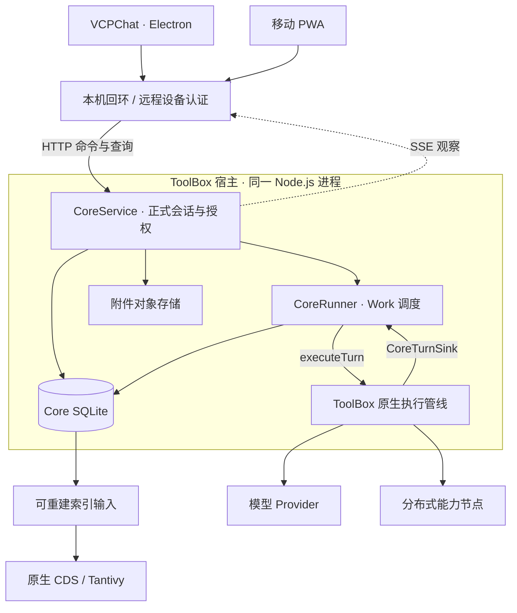
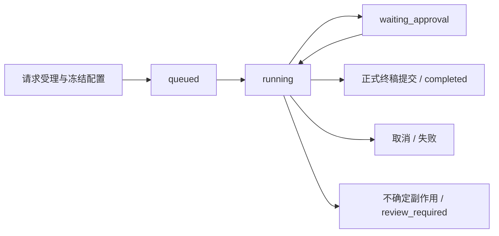

# VCP Core · 现行架构

**基线：Pilot 01-R（`0a1f358`）**。本文描述该固定候选在 `main` 所继承的运行架构；后续实现变化应同步修订本文。详细接口以对应源码为准。

## 设计目标与边界

将正式会话与执行生命周期集中在一个逻辑 Core 内，使多个客户端可以随时连接、离开或继续交互，而不是在客户端之间转移执行所有权。

- 每个个人工作空间只有一个正式会话权威，不采用多主写入、离线自动合并或设备之间的执行接管。
- Core 与 ToolBox 在同一 Node.js 进程中运行。模型预处理、工具循环与原生插件仍使用 ToolBox 实现，不另造通用 Agent 执行引擎。
- 本机与远程模式共用会话存储、Work 调度、配置、上下文和附件；接入身份不同，正式会话语义相同。
- 原生领域资源仍由各自领域所有者管理。Core 不是所有 VCP 数据、记忆或工具副作用的统一数据库。

## 总体结构

| 模块 | 当前职责与源码入口 |
| --- | --- |
| 宿主生命周期 | [server.js](../apps/server/server.js) 与 [core/host.js](../apps/server/core/host.js)：创建、排空和关闭 Core，按模式挂载访问入口。 |
| 会话服务 | [core/service.js](../apps/server/core/service.js)：命令、查询、权限复核、话题及配置访问、附件、观察流。 |
| 执行与恢复 | [core/runner.js](../apps/server/core/runner.js)、[core/turnSink.js](../apps/server/core/turnSink.js)：独立取消信号、正式终稿提交及观察事件。 |
| 持久化 | [core/store.js](../apps/server/core/store.js)：SQLite 事实、消息变更、Work、工具调用及请求回执。 |
| 工作空间与设备 | [core/localWorkspace.js](../apps/server/core/localWorkspace.js)、[core/remoteAccess.js](../apps/server/core/remoteAccess.js)：个人目录、配置、删除墓碑、远程设备权限。 |
| 桌面与手机 | [localCoreRuntime.js](../apps/desktop/modules/services/localCoreRuntime.js)、[App.vue](../apps/mobile/src/App.vue)：客户端接入、视图与用户交互。 |

## 运行形态与接入

| 模式 | 访问边界 | 正式会话与执行 |
| --- | --- | --- |
| `local` | 同机认证回环，ToolBox Bearer；桌面使用独立 Profile。 | 独立 Core，不需要加载 NativeSync。 |
| `remote` | 后端回环监听；受信任 HTTPS 代理；桌面设备凭据或 PWA 会话。 | 与 local 共用 Core 实现，不需要加载 NativeSync。 |
| `shared` | 显式选择的旧共享授权适配器。 | Core 接管范围仍由 Core 提交；旧共享消费者与兼容入口保留。 |

远程模式面向一个个人工作空间，不是多租户服务。代理仅转发 `/core/api/` 和 `/mobile/`，覆盖 Host 与转发协议信息，关闭 SSE 缓冲。ToolBox Key 不能冒充远程设备凭据。

配对由 [pairDevice.js](../apps/server/core/pairDevice.js) 生成短时一次性码，区分管理桌面、配置只读桌面、可交互手机及只读手机。设备权限可撤销；设备配对不授予原生可信人类审批资格。

客户端绑定 origin、workspace 与数据库 `storageId`。同地址换库时拒绝静默接管；旧 Profile 的首次升级需要显式核对原库身份。恢复旧快照可能保留相同身份，所以身份绑定不能代替备份和数据核对。

具体操作见 [部署、配对及备份恢复](core-pilot-01-r.md)。

## 正式数据与领域权威

| 事实或状态 | 所有者 |
| --- | --- |
| Core 已登记话题、Agent 配置、正式消息及编辑删除事实 | Core SQLite |
| 已受理 Work、配置快照、请求回执及必要工具结果 | Core SQLite |
| 附件原件及消息引用 | Core 数据目录内的对象存储及正式消息绑定 |
| 会话展示、流式增量与连接状态 | 客户端视图；不是正式提交权威 |
| CDS/Tantivy 搜索索引 | 原生 CDS，从 Core 正式事实派生，可重建 |
| AgentAssistant 子任务、Canvas、Workspace、私有牌局 | 各原生领域服务或注册能力节点 |
| 长期记忆、OneRing、Tavern 等原生能力 | 各自原有归属；不视为 Core SQLite 内的同一事务 |

Core 正式消息不再依赖桌面 History 共同写入。SideChat 的合法原生旁路子话题仍有自己的本地写入归属，不能据此推定全部桌面领域数据已集中到 Core。

## Work 执行生命周期

- 请求身份与回执用于核对重复提交。每个话题由 CoreRunner 协调正式执行顺序，已受理 Work 使用其冻结配置与明确上下文边界。
- Work 直接通过原生 `executeTurn` 执行。CoreTurnSink 将文本、推理、工具展示等观察事件与正式终稿提交分开。客户端断线或退出不会因此取消 Work。
- 取消、追加输入及任务控制按实际权限与原生语义处理；并非每一种群聊或领域工作都具备相同控制能力。
- 恢复以数据库事实为准。确认未派发且仍可执行的工作可恢复队列；已有可靠终态按原身份核对；不能确定的派发或工具副作用保留待核对，不盲目重放。
- OneRing、Tavern 等交互收尾复用原生能力，正式提交后的调用是尽力而为的独立操作，并不承诺与 Core 跨域原子提交。

Core 的承诺是明确执行归属、恢复已确认事实及避免不安全的盲重试，不是恢复任意进程内状态、所有工具都恰好执行一次或重放完整流式 token。

## 存储、检索与历史迁移

Core 使用 Node 24 的 `node:sqlite`，SQLite WAL 与正式消息表配合轻量变更日志。Work、工具 invocation 与幂等回执保存必要执行事实；变更日志不作为另一份永久正文权威。

[core/cdsIndex.js](../apps/server/core/cdsIndex.js) 在检索前将授权范围内的正式消息生成独立可重建索引输入，再使用原生 CDS/Tantivy reconcile。DeepMemo 复用原生带权、排除及相邻窗口语义，TopicMemo 从授权的 Core 正式历史读取。删除墓碑阻止已删除对象重新进入正式目录、历史与附件读取。当前不是持续推送索引架构，真实大规模索引成本仍需日用测量。

[core/importHistory.js](../apps/server/core/importHistory.js) 负责离线历史导入。支持范围以实际格式验证为准，保留可定位附件、原有顺序及删除事实。跨话题重复 ID、非文本内联部件和缺失附件仍明确拒绝，不静默丢弃。新旧工作空间不能共同写入；完整真实日用历史尚需单独迁移验收。

备份需正常停机后保护完整 Core 数据目录（含数据库、附件和设备会话），并单独保护必要 ToolBox 配置及 Agent 文件。保留旧安装包不是新数据的回退机制。

## 原生能力与目前边界

- 单聊、常规群聊、JEV 动态仲裁、斗地主公开会话、AA 受准委派、TopicSponsor、单聊 Flowlock 与压缩已在相应范围内接入；保留原生资源所有者与授权。
- JEV 仲裁继续复用原生编排器。后台进程重启时原仲裁会话暂停，不承诺恢复任意仲裁进程状态。游戏私有牌局仍归原生 GameService；VTrade 等独立领域仍使用其入口。
- 群聊 Flowlock、压缩、Steering 没有被扩大为新的通用功能。AA 临时联系、额外工具注入与间接委派仍有限制。语音、桌宠等保留原生模块，实际设备兼容不能由单聊测试推定。
- Resident 正向 Provider Seal、生产可信人类审批和 WebTransport 为独立工作项；当前通信为 HTTP + SSE。高敏权限不可通过普通配对绕过。
- Linux 后端及桌面、Windows 客户端安装启动、Android Firefox 隔离多端等已有分范围证据。Windows 后端、macOS、完整日用迁移及长期真实负载不在已确认的完整验收范围内。

详细阶段证据见 [历史档案索引](archive/README.md)。日用候选风险回执见 [pilot-risk.json](evidence/core-pilot-01-r/pilot-risk.json)。

## NativeSync 的现行定位

NativeSync 提供了早期跨端工程基础。Core 继承可复用的认证、配置、附件、上下文、请求回执及恢复实现，但新 local / remote 模式不要求加载其同步运行时，也不依靠旧双向副本、接管与终稿补交。源码路径中仍存在 NativeSync 通用模块的引用，不能据此断言旧运行时仍在执行。

显式 shared 模式及旧协议消费者尚保留。历史版本与证据保留在原分支、标签和档案索引中；不为目录名称而重写成熟实现，也不新增永久双写权威。
