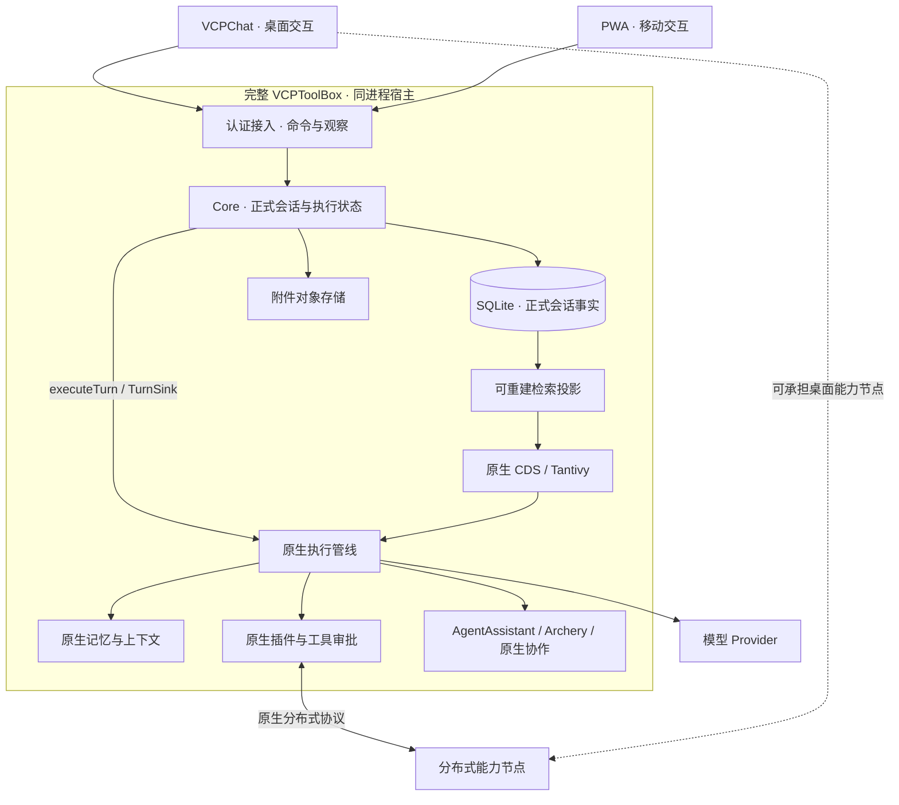

# VCP Integrated · 产品愿景与终局架构

> 本文定义长期产品目标与目标架构，不是现行能力清单、部署授权或阶段任务书。施工纪律见 [AGENTS.md](../AGENTS.md)，当前实现、过渡路径及验收边界见 [ARCHITECTURE.md](ARCHITECTURE.md)。

## 1. 我们要建设什么

**让完整的 VCPToolBox 获得持续在线的生命状态与跨端连续性。**

VCP Integrated 面向个人自托管工作空间，将 VCP 原生认知、记忆、工具执行与 Agent 协作能力，同一个持续持有正式会话状态和执行生命周期的内核结合。

Agent 的会话不再依附于某个桌面窗口或某台客户端。用户可以在桌面开始工作、离开设备、从手机查看执行进展或继续交流，再回到另一台桌面；接续的是同一份正式会话与执行事实，而不是复制出另一份 Agent 历史。

**不是 Core 管理 VCPToolBox，而是完整的 VCPToolBox 获得了 Core 状态内核。**

这里的持续在线指宿主运行期间状态与执行不依赖客户端连接，并能在重启后恢复已确认事实；不表示模型持续推理，也不承诺无条件持续执行、任意后台任务跨重启续跑或设备永不掉线。

## 2. 终局架构

一个工作空间只有一个正式会话权威。客户端通过认证接入同一个宿主；本机与远程运行形态共用同一内核和正式数据格式。

VCPToolBox 保持原生运行时主体。Core 与其同进程执行，提供唯一正式会话事实、Work 生命周期、附件绑定、设备接入与恢复决策。领域能力直接复用原生运行机制，不再逐项移植到 Core 中。

分布式能力节点可以位于用户授权的桌面或其他设备，继续持有各自的本地能力与资源。依赖某个节点的任务仍须尊重该节点的实际在线状态、能力配置与授权。

## 3. 领域权威

| 领域 | 终局所有者与责任 |
| --- | --- |
| Agent / Group / Topic 正式会话定义、消息、删除事实 | Core；一个工作空间内唯一正式事实来源 |
| Work 受理、执行快照、幂等、正式终稿及恢复决策 | Core；确认事实与不确定副作用分开记录 |
| 附件对象与消息绑定 | Core；原件与正式引用可独立核对 |
| 原生预处理、模型调用、工具循环、插件配置及生命周期 | VCPToolBox；Core 不另建通用 Agent 引擎 |
| 日记、认知检索、OneRing、Tavern 等记忆与领域状态 | 原生领域所有者；Core 不建设平行记忆系统 |
| 工具审批与实际操作 | 原生授权机制及执行节点；设备接入权限不替代可信人类审批 |
| AA、Archery 及独立后台任务 | 原生任务所有者；与父 Work 有清晰的受理、交接和取消边界 |
| 语音、表情、游戏、Canvas、Workspace 等 | 各原生领域或独立服务；Core 不吞并领域业务 |
| 搜索索引 | 原生 CDS / Tantivy；从正式会话事实派生，可重建 |
| UI、流式展示、设备连接 | 客户端视图；不成为正式历史的共同写入者 |

## 4. 理想日用体验

- **同一个 Agent，而不是同步出来的副本。** 桌面与手机看到同一个话题、消息、附件和已受理任务；编辑、删除与继续交互遵循同一个正式事实。
- **交互可以离开，执行不必离开。** 客户端断开不自动取消已受理的 Work。用户重新连接后查看实际进度和正式结果，必要时按原有权限继续交流或取消。
- **原生认知能力保持完整。** 在已启用、受授权且环境支持的范围内，Agent 按原生机制使用日记、联合检索、上下文、工具及协作；不会因为使用 Core 而依赖另一个缩减版引擎。
- **多端各有价值。** 桌面承载完整工作环境与原生桌面能力，手机提供便携的浏览、交流和任务观察；分布式节点提供实际执行能力。不同入口不要求界面功能完全相同，但共同会话事实必须一致。
- **真实而可控的恢复。** 能确认的操作按原身份读回，明确未派发且仍有效的工作可以恢复；未知副作用留待核对，不伪装成功，不盲目重跑。高敏操作仍遵守可信人类授权。
- **长期日用而非反复工程试验。** 正常启动、升级、备份、恢复和历史迁移都有可重复入口；日用数据与发行源码分离。

## 5. 非目标

本项目不是：

- 新建一个取代 VCPToolBox 的 Agent 框架、记忆引擎、工具审批系统或插件生态。
- 客户端之间的双向 History 同步、多主数据库、离线写自动合并或自动执行权迁移系统。
- 多租户 SaaS、所有领域资源的中央数据库，或保证每个外部副作用恰好执行一次的跨域事务平台。
- 以插件数量、测试数量、总代码行数或协议复杂度作为先进性的度量；也不为未来假设需求预建永久兼容与治理层。
- 对任意插件、设备或操作系统无条件可用的承诺。原生依赖、能力启用、授权及平台支持仍须真实成立。

## 6. 终局完成标准

以下标准衡量目标架构是否成立，不是新增一套逐插件准入制度，也不代表当前已经验收。

| 维度 | 可观察的完成条件 |
| --- | --- |
| 会话与多端连续性 | 桌面、PWA 围绕同一正式话题和 Work 交互；断连、重开及重启后不复制历史、不盲目重派发 |
| 原生能力继承 | 原生记忆、工具、审批、分布式执行、AA 和 Archery 在支持范围内沿用原生机制；不再存在 Core 类别性封禁或专用替代管线 |
| 权威与恢复 | 单一正式写者、幂等回执、删除事实及附件绑定一致；原生独立任务可按其真实状态观察和结算 |
| 架构收敛 | 主线退出旧 shared 与双向同步运行时，保留成熟可复用模块；Core 只承担其必要的状态与执行职责 |
| 个人日用 | 已有真实历史、Agent 配置和附件可在明确迁移范围内保留；典型日用任务与实际设备得到验证，真实未支持范围公开说明 |
| 运维与演化 | 可复建发行、备份恢复和代码回退有实证；产品继续演化原生能力时不需要重新建设 Core 准入体系 |

达到上述目标后，项目从架构收敛进入日用演化。新的工作由真实用户需求、上游能力变化或实际缺陷驱动，而不是继续扩张 Core 的职责。

## 7. 文档与演进

- [VISION.md](VISION.md)：长期产品愿景、目标架构、领域权威及完成标准。
- [AGENTS.md](../AGENTS.md)：施工纪律和不可破坏的工程边界。
- [ARCHITECTURE.md](ARCHITECTURE.md)：当前实现、验收范围、过渡路径与纠偏路线。
- [文档导航](README.md) 与 [历史档案](archive/README.md)：操作入口、阶段记录和证据。

愿景变化属于产品架构决策；当前工程状态由现行文档和源码如实反映。历史阶段的成功不自动等于终局达成。
